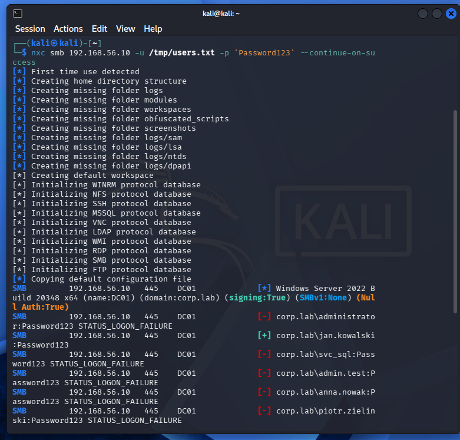
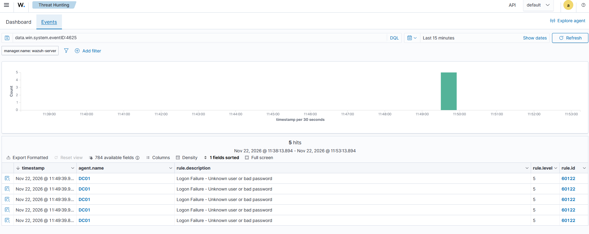
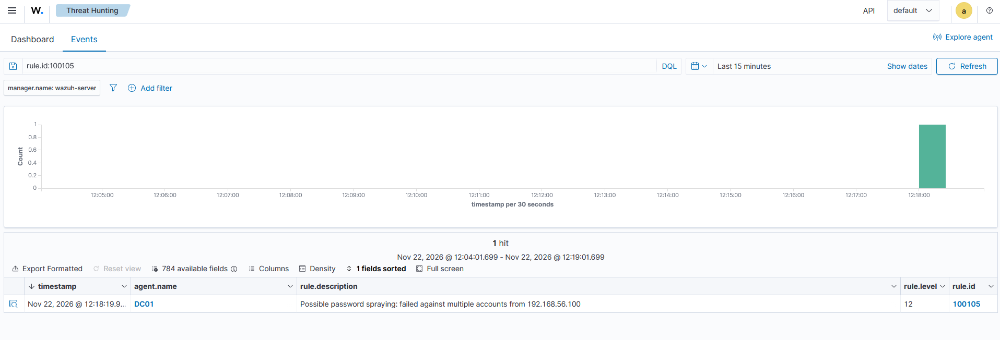

# Scenario 07 — Password Spraying → Domain Accounts

> **MITRE ATT&CK:** [T1110.003 — Brute Force: Password Spraying](https://attack.mitre.org/techniques/T1110/003/)
> **Tactic:** Credential Access
> **Target:** DC01 (192.168.56.10) — domain controller, `corp.lab`
> **Attacker:** KALI (192.168.56.100)
> **Accounts targeted:** `administrator`, `jan.kowalski`, `svc_sql`, `admin.test` + non-existent names

---

## 1. Summary

Where a brute force hammers **one account with many passwords** (Scenario 01),
password spraying flips it: **one password tried against many accounts**. The
attacker avoids account lockouts by keeping attempts-per-account low, and relies
on at least one user having a weak, common password.

An attacker on the internal network sprayed a single common password
(`Password123`) across a list of domain accounts against the domain controller.
Each attempt produced a **Windows Event ID 4625** (failed logon) on DC01. The key
signal is not any single failure but the **pattern**: many *different* accounts
failing from the **same source IP** in a short window — which a custom Wazuh rule
(100105) correlates into one high-severity alert.

---

## 2. Attack (from Kali)

> ⚠️ **Lab note.** Run only against accounts in this isolated lab. Spraying real
> accounts without authorisation is illegal.

**Build the user list** (mix of real and non-existent accounts, so the logs show
both "bad password" and "unknown user" failures):

```bash
cat > /tmp/users.txt <<'EOF'
administrator
jan.kowalski
svc_sql
admin.test
anna.nowak
piotr.zielinski
EOF
```

**Spray one password across all of them** with netexec (pre-installed on Kali):

```bash
nxc smb 192.168.56.10 -u /tmp/users.txt -p 'Password123' --continue-on-success
```

- `-u /tmp/users.txt` — the account list
- `-p 'Password123'` — a single password (that's what makes it a *spray*)
- `--continue-on-success` — keep going after a hit, so every account is attempted

**Result:** netexec marks valid pairs with `[+]`, failures with `[-]`:

```
SMB  192.168.56.10  445  DC01  [-] corp.lab\administrator:Password123 STATUS_LOGON_FAILURE
SMB  192.168.56.10  445  DC01  [+] corp.lab\jan.kowalski:Password123
SMB  192.168.56.10  445  DC01  [-] corp.lab\svc_sql:Password123 STATUS_LOGON_FAILURE
...
```



*The full spray — one password against six accounts, one valid hit on `jan.kowalski`.*

---

## 3. What it looks like in the logs

Every failed attempt produced a **Windows Event ID 4625** on DC01, forwarded by
the Wazuh agent. What separates a spray from a brute force:

| Field | Value |
| --- | --- |
| Event ID | 4625 (failed logon) |
| Logon type | 3 (network / SMB) |
| Source IP (`win.eventdata.ipAddress`) | 192.168.56.100 |
| Target users | administrator, svc_sql, admin.test, anna.nowak, … |

- **Same** source IP, **many different** `targetUserName` values, **low** count
  per account.
- Each 4625 fires built-in rule **60122** (level 5) — individually low-signal.



*Wazuh Events — a cluster of 4625 events from one source IP hitting several different usernames.*

---

## 4. Detection logic

A single failed logon is noise. The spray is caught by a **custom correlation
rule** that recognises the pattern: many *different* accounts, same source, short
window.

```xml
<rule id="100105" level="12" frequency="5" timeframe="120">
  <if_matched_sid>60122</if_matched_sid>
  <same_field>win.eventdata.ipAddress</same_field>
  <different_field>win.eventdata.targetUserName</different_field>
  <description>Possible password spraying: failed logons against multiple accounts from $(win.eventdata.ipAddress)</description>
  <mitre>
    <id>T1110.003</id>
  </mitre>
</rule>
```

- `if_matched_sid` 60122 — count the individual failed logons.
- `same_field` on the source IP — all failures from one attacker.
- `different_field` on the target username — spread across accounts. **This is the
  line that separates a spray from a single-account brute force.**
- `frequency` / `timeframe` — 5 distinct-account failures within 120 seconds.

**Deploy:**

```bash
sudo nano /var/ossec/etc/rules/local_rules.xml   # add rule inside <group>
sudo /var/ossec/bin/wazuh-logtest -t             # verify config parses
sudo systemctl restart wazuh-manager
```

Re-running the spray then fires rule **100105** at level 12, correlating all five
failed accounts into one alert:



*Rule 100105 fires once, level 12, attributing the spray to source 192.168.56.100.*

> **Tuning note.** 100105 depends on `win.eventdata.ipAddress` being populated.
> Logon type 3 (SMB) fills it; some other logon types log the source as a
> hostname instead, where correlating on `win.eventdata.workstationName` is more
> reliable.

---

## 5. Response — SOC L1 checklist

1. **Confirm the pattern.** One source IP against several accounts = spraying, not
   a single-user brute force.
2. **Check for success.** Search the same source IP for a **4624** (successful
   logon) right after the failures. A hit means an account is compromised —
   escalate. *(Here: `jan.kowalski` succeeded.)*
3. **Identify the source.** 192.168.56.100 → which host is that? Internal foothold
   or external?
4. **Scope it.** Which accounts were targeted? Any privileged (`admin.test`,
   `administrator`)?
5. **Contain.** Force-reset any account that logged a 4624; isolate the source.
6. **Document.** Incident report (below).

---

## 6. Incident report

```
Incident:      Password spraying against corp.lab domain accounts
Detected:      <date/time>  —  Wazuh rule 100105 (level 12)
Source:        192.168.56.100 (KALI)
Targets:       administrator, jan.kowalski, svc_sql, admin.test, anna.nowak, piotr.zielinski
Technique:     MITRE T1110.003 — Password Spraying
Evidence:      5× Event ID 4625 from one source IP across distinct accounts in <2s;
               1× Event ID 4624 (jan.kowalski) — ACCOUNT COMPROMISED
Impact:        One standard domain account compromised (jan.kowalski)
Actions:       Reset jan.kowalski password; isolated source host; reviewed
               jan.kowalski activity post-logon
Recommend:     Strong-password policy; account lockout threshold; MFA on remote
               access; alert on rule 100105 going forward
```

---

## 7. What I learned

- Spraying vs brute force: the detection pivots on **different accounts, same
  source**, not on raw failure count.
- Built-in rules see the individual 4625s; catching the *campaign* needed a
  **frequency + different_field** correlation rule — my first custom
  correlation (vs. the field-match rules in 100100–100104).
- The follow-up 4624 search is what turns "suspicious" into "confirmed
  compromise" — the L1 judgement call.
